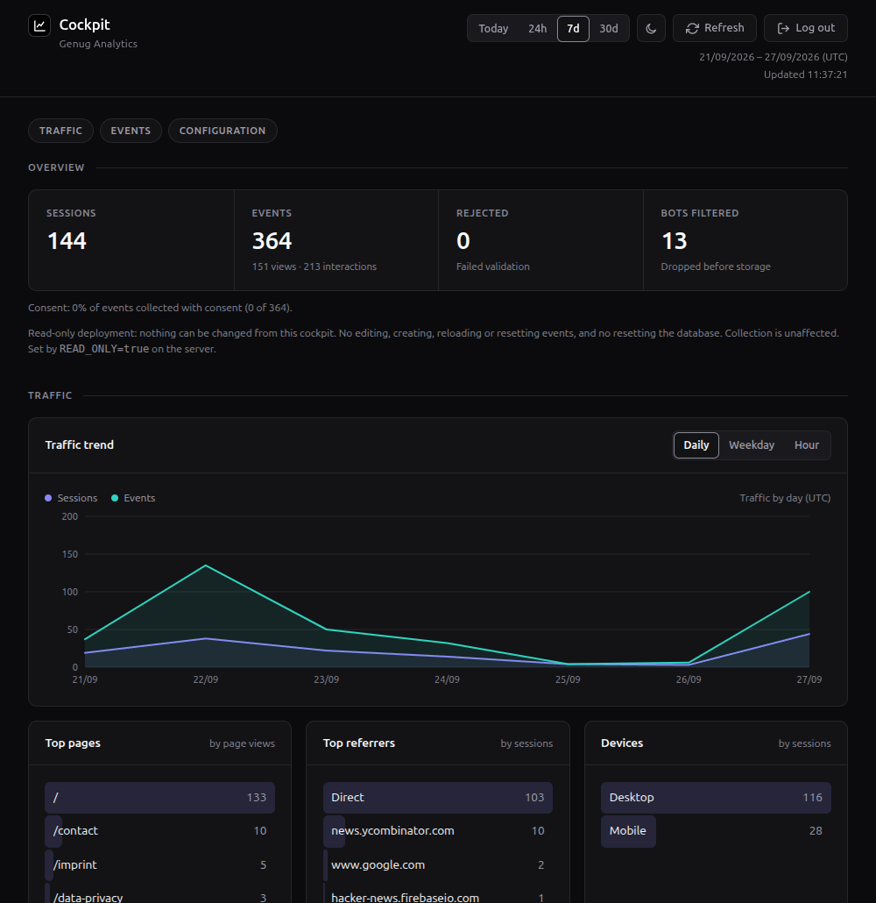

# Genug Analytics

[](https://github.com/datapip/genug-analytics/actions/workflows/ci.yml)
[](LICENSE)

**Self-hosted web analytics you query by asking an AI agent, instead of
reading a dashboard.**

A script tag on your site sends events to a server you run. Then you
ask — in Claude, Cursor, or any MCP client — and the agent answers from
your own data:

> **You:** Did anything unusual happen on the site last week?
>
> **Agent:** Interaction events were up about 35% last Tuesday — almost
> entirely `outbound_link_click` on your GitHub link, not more page
> views. Worth checking what pointed there that day.

_Genug_ is German for _enough_: just enough analytics to answer your
questions, and nothing to operate beyond one process and one file.

**Status:** alpha. Running in production on the maintainer's own sites.
The shape of things may still change before 1.0; see
[CHANGELOG.md](CHANGELOG.md).

## Why

- **Ask, don't read.** 34 MCP tools, each answering one question a site
  owner actually asks: top pages, where traffic comes from, which
  campaign converted, whether a drop is real. Every tool can be narrowed
  to a segment, so "where did the buyers of product X come from" is one
  question.
- **Radically small.** One Node process, one SQLite file. Your own
  events are one JSON file each, live the moment you save.
- **Privacy by architecture.** No cookie by default: the visitor ID is
  a daily-changing hash, and the address it comes from is never stored
  in the database.
  Query strings are filtered before storage. Consent switches on a
  first-party cookie, and an opt-out is built in.

A small cockpit is there for when you want to look rather than ask:



## Quick start

1. **Point a subdomain at your server**, such as `data.your-domain.com`,
   as DNS only (no Cloudflare proxy).
2. **Install it** on a fresh Ubuntu server. It asks for the hostname,
   your site's origin and a password, and sets up HTTPS:

   ```sh
   curl -fsSL https://genug-analytics.com/install.sh | sudo bash
   ```

3. **Put the script on your site**, early in `<head>`:

   ```html
   <script>
     window.genugAnalyticsConfig = { enableAutoPageTracking: true };
   </script>
   <script defer src="https://data.your-domain.com/client.js"></script>
   ```

4. **Connect your agent.** For Claude Code:

   ```sh
   claude mcp add --transport http genug https://data.your-domain.com/mcp \
     --header "Authorization: Bearer YOUR_MCP_API_KEY"
   ```

   Then ask: _"What were my top pages this week, and where did that
   traffic come from?"_

Step by step, with troubleshooting: [getting started](docs/getting-started.md).
Coolify or Docker by hand: [deploying](docs/deploying.md#installing).

Before going live, decide what your privacy notice says, how long you
keep data (13 months by default), and whether you need a consent
banner. That last one is a question for your lawyer.
[Privacy](docs/privacy.md) lists what Genug stores and has a template.

## Tracking your own events

Page views, outbound clicks and file downloads are built in. The last
two are off until you add `enableAutoLinkTracking: true` to the config.
Define anything else in the cockpit or as one JSON file, then send it:

```js
window.genugAnalytics.track("order_completed", { order_total: 49.9 });
```

```html
<button data-genug-on-click="cta_click">Upgrade</button>
```

An event that doesn't match its definition is rejected and counted in
the cockpit, with the reason. More in [client.md](docs/client.md).

## Docs

- [Connecting an agent](docs/mcp.md): every client, telling the agent
  about your site, what leaves your server
- [The client script](docs/client.md): consent, single-page apps,
  custom events
- [Privacy](docs/privacy.md): what is stored, and a policy template
- [Operations](docs/operations.md): capacity, retention, backups,
  restore, erasure, export
- [Weekly digest](docs/digest.md): a ready-made prompt

## Make it yours

You run your own copy, so change it. Three recipes are written to be
followed end to end, by you or by an AI coding assistant:

- [Add a tracked event](docs/recipe-add-event.md)
- [Add an MCP tool](docs/recipe-add-mcp-tool.md)
- [Change the cockpit](docs/recipe-change-cockpit.md)

An assistant working in this repo reads [AGENTS.md](AGENTS.md), the
rules that keep a change from producing numbers that look right but
aren't. The reasoning is in [docs/decisions.md](docs/decisions.md).

```sh
npm install
npm run build && npm test && npm run lint
```

## License

MIT — see [LICENSE](LICENSE).
